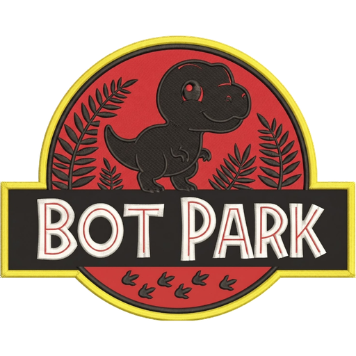

<div align="center">
  
  <h1>🦖 Bot Park</h1>
  <p><strong>Multi-Agent AI Workspace • Independent Identities, Live Voice Call & Virtual Computer</strong></p>
</div>

---

## ✨ Caratteristiche Principali

- **🦖 Capo Bot & Forgiatore di Agenti**: parte in modalità **Vergine** con un singolo **Capo Bot** in grado di creare nuovi agenti specializzati su misura direttamente dalla chat (`<<<CREATE_BOT>>>`) o tramite il creatore visuale.
- **🧠 Identità e Memoria Indipendenti**: ogni agente mantiene il proprio System Prompt, la propria cronologia conversazionale, la propria forma geometrica animata, la propria voce e la propria **Libreria di file su disco** (`workspaces/<botId>/`).
- **💬 Comunicazione Autonoma Inter-Agente**: gli agenti possono delegarsi compiti tra loro (`<<<SEND_TO_BOT>>>`) e rispondere nella propria chat dedicata.
- **🎙️ Chiamata Vocale Live Full-Duplex**: telefonata vocale in tempo reale con rilevamento automatico del parlato (VAD), **Gemini Multimodal Audio API** e sintesi vocale **ElevenLabs** (con fallback automatico a Web Speech API).
- **💻 Virtual Computer Integrato**:
  - **Terminale Reale** collegato alla cartella di lavoro dell'agente.
  - **File Manager & Editor su Disco** per leggere, modificare e salvare file reali.
  - **Browser Web Live** per estrarre il contenuto di qualsiasi pagina web o video YouTube e consultare meteo e notizie in tempo reale.
  - **Bridge Android TV (ADB)** opzionale per controllare una Smart TV sulla rete locale.
- **⏰ Scheduler di Routine Giornaliero**: pianifica task ricorrenti per qualsiasi agente ad orari prestabiliti (`HH:MM`).
- **🔐 Cassaforte Locale (Vault)**: gestione locale di chiavi, token e segreti (esclusa automaticamente da Git tramite `.gitignore`).

---

## 🚀 Avvio Rapido

### 1. Clona il repository e installa le dipendenze
```bash
git clone https://github.com/DinoGaeta/bot-park.git
cd bot-park
npm install
```

### 2. Configura le tue API Key
Copia il file `.env.example` in `.env` e inserisci la tua chiave API di **Google Gemini** (ed eventualmente **ElevenLabs**):
```bash
cp .env.example .env
```

### 3. Avvia Bot Park
```bash
npm run dev
```
L'interfaccia sarà subito disponibile su `http://localhost:5173`.
